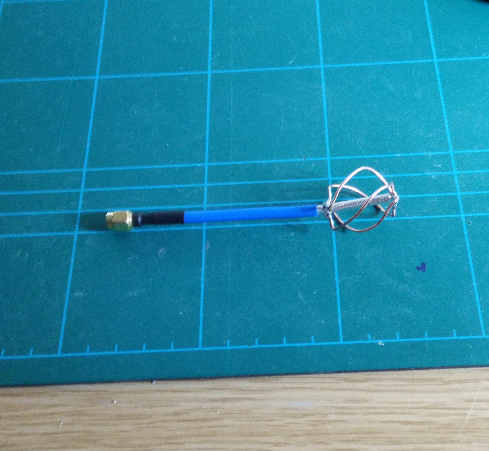
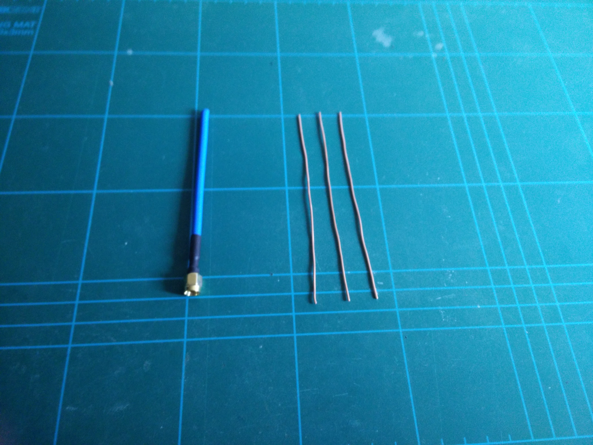
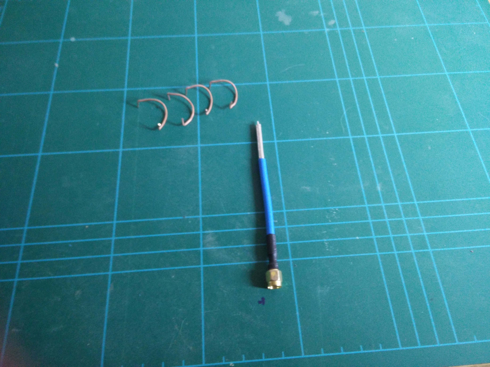

I followed Andrew McNeil's design for a 5.8GHz Quadrifilar
Helix Antenna. This was to replace a crappy omni whip antenna
that came with an RC852 video rx.

I ordered some semi rigid coax from ChinaRF on eBay and I used
some earth wire from some scrap 2C+E i had laying around. I
tried to straighten it as best i could!

Bending the shape of the lobes was harder than expected. I
posted on reddit and someone suggested using a 3D Printer to
create a jig. One for the future i think!

It works better than expected. I hooked it up to my HackRF
and compared the received signal from my FPV racing quad.
With the original omni i was seeing peaks at -65dbm but with
this i reliably get to -55dbm in the same test conditions and
subjectively much better signal when the quad is moved around.
